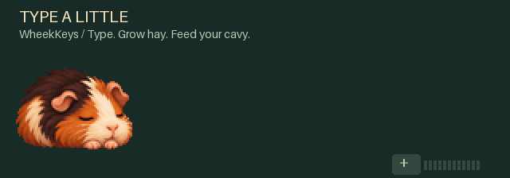

# WheekKeys — Guinea Pig Desktop Pet

**Type a little. Grow hay. Feed your cavy.**

English · [简体中文](README.zh-CN.md)



[](https://github.com/destined108/WheekKeys/actions/workflows/windows.yml)
[Make your own cavy](#make-your-own-cavy) — send [this skill](.agents/skills/create-guinea-pig/SKILL.md) and your pet’s photo to your agent.

> Early prototype. No installer or Release is available yet. The button opens Windows CI builds: choose a successful run, download **Artifacts → WheekKeys-Windows**, unzip, and run `WheekKeys.exe`. GitHub sign-in is required for artifact downloads. The executable is unsigned. Download a build from the latest commit to get the updated typing detection.

## A tiny typing companion

Open WheekKeys, leave it running in the corner, and type normally in Notepad or another app. Each new key press grows a blade of hay and briefly lights the little key under the grass. Fill the twelve-segment meter and Potato scurries over, chews, then returns to loaf mode. Holding a key counts once.

- Windows 10/11: transparent, always-on-top corner window.
- Drag with the left mouse button. Right-click to feed manually or quit. Esc quits when the pet window has focus.
- No account, points, or network services.
- `--demo` is an automatic ten-second preview, **not live typing mode**. Launch without it for real keyboard interaction.

The GIF and `--demo` use the same fixed-step scene, twelve simulated taps, renderer, and feedback as the application. The GIF is a rendered preview, not a Windows screen recording. Live input naturally follows your own typing speed.

## Tray, models, and settings

The **Language** submenu in both the pet and tray menus offers **Follow system**, **简体中文**, **繁體中文**, and **English**. Changes apply immediately and are remembered. Follow system uses your Windows display language at startup: Simplified Chinese for mainland China and Singapore, Traditional Chinese for Taiwan, Hong Kong and Macau, and English for other languages. Explicit Hans/Hant script tags take precedence over region when available. Restart WheekKeys after changing the system display language.

The Windows app adds a guinea pig icon to the system tray (it may be under the tray's hidden-icons arrow). Right-click the icon or the pet to access models, colors, settings, manual feeding, and quitting. The tray also lets you hide and restore the pet.

**Settings** offers keys per meal (1–1000), movement speed (0.5–2×), display size (0.5–2×), always-on-top, and pausing keyboard interaction. Click **Save** to apply and remember changes. Pausing ignores typing while the current animation can finish; manual feeding remains available. Dragged window positions are remembered too.

**Pet model** selects an installed character. One model, Potato, is bundled. **Import model…** installs a full animation pack; **Import colors…** changes only its palette. **Export model template…** saves an editable copy of the current character. See [model pack format](models/README.md). Switching models restores that model's own colors.

Preferences, imported models, and palettes live under `%APPDATA%\WheekKeys`, outside the exe. If the tray cannot start, the pet's right-click menu remains available and hiding is disabled.

## Keyboard privacy

On Windows, a message-pumped keyboard hook counts new key-down events, including short taps between animation frames. It does not convert keys to text, inspect window titles or clipboard contents, save events, or send them anywhere. Only a pending count and the set of currently held key identifiers are kept in memory for repeat filtering; released keys are removed. Modifiers and mouse buttons do not count. The hook passes input through and is removed on exit. No administrator access is normally needed. Windows secure desktops are outside its scope.

## Run from source

Install Python 3.12 with Tk, then run from the repository root:

```powershell
py -3.12 -m venv .venv
.venv\Scripts\python -m pip install -r requirements.txt
.venv\Scripts\python -m wheekkeys
```

Preview without global input (also available on Linux/macOS with a display):

```powershell
.venv\Scripts\python -m wheekkeys --demo
```

Use a custom palette:

```powershell
.venv\Scripts\python -m wheekkeys --skin skins\template.json
```

## Develop and build

```sh
python -m pip install -r requirements.txt
python -m unittest discover -s tests -v
python -m docs.make_demo
```

Package on Windows:

```powershell
python -m pip install pyinstaller==6.16.0
python -m PyInstaller --noconfirm --clean --onefile --windowed --name WheekKeys --icon assets/wheekkeys.ico --hidden-import pystray._win32 --add-data "skins;skins" --add-data "assets;assets" launcher.py
```

Output: `dist/WheekKeys.exe`. CI tests and packages the app, uploads an artifact, and does not publish Releases.

Windows acceptance check: launch without `--demo`, switch to Notepad, type twelve quick taps, and verify twelve feedback pulses, a full meter, and one feeding cycle. Hold a key to verify repeat filtering. Check dragging, quitting, demo mode, and custom skins. Automated tests cover counting, feedback, scene timing, animation, and palettes; native Windows desktop/hook behavior still requires Windows verification.

## Make your own cavy

Send your coding agent [the create-guinea-pig skill](.agents/skills/create-guinea-pig/SKILL.md) and a photo or description of your pet. Copy this prompt:

> Read `.agents/skills/create-guinea-pig/SKILL.md` in this repository and follow it to make my guinea pig from the attached reference. Name: ____. Change only the coat colors if that is enough; otherwise create a full model. Validate the result, give me a preview and the importable files, and tell me how to install them. Keep my reference photos out of the deliverable.

If your agent discovers repository skills, you can invoke **`$create-guinea-pig`** directly. Otherwise paste the contents of [SKILL.md](.agents/skills/create-guinea-pig/SKILL.md) into the chat. The agent needs access to this checkout and its Python dependencies; new artwork also needs an image tool or your supplied sprites.

The same skill handles **coat colors and complete models**. It chooses the right workflow, prepares the resources, and explains the correct import:

- **Colors only:** the agent delivers `skin.json` plus a preview. Choose **Import colors…** in the pet or tray menu and select that JSON file.
- **New character:** the agent delivers a model ZIP plus a preview. Unzip it, choose **Import model…**, and select the folder containing `model.json`.

For contributors, palette resources go in `skins/community/<slug>/`; full model resources go in `models/community/<slug>/`. Download ZIPs go in `dist/`. The app copies imports into your user data folder; you do not need to edit files beside the exe or rebuild it. The [model format reference](models/README.md) is available for artists who want to work manually.

Share your preview in an Issue or submit your resources in a PR. If Potato makes you smile, give the project a Star or share the ten-second clip with a guinea pig friend.

MIT License. Character sprites were created with AI assistance using a supplied visual reference. Project-provided artwork is distributed under the repository's MIT license.
