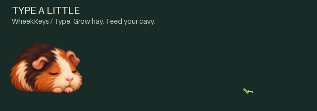

# WheekKeys — Guinea Pig Desktop Pet / 豚鼠桌宠

**敲键盘长牧草，豚鼠跑来吃。** Type a little. Grow hay. Feed your cavy.



[](https://github.com/destined108/WheekKeys/actions/workflows/windows.yml)
[花色模板](skins/template.json) · [做一只你家的豚鼠](skins/README.md)

> 首个原型，尚未发布 Windows 安装包。按钮前往 Windows 构建页：成功运行后，在 **Artifacts → WheekKeys-Windows** 下载 ZIP，解压运行 `WheekKeys.exe`（下载 Actions 产物需要登录 GitHub）。也可以按下面的方法从源码立即试用。当前 GIF 由应用同一套绘图与状态逻辑生成，并非 Windows 桌面录屏。

## 十秒就懂

打约 12 次键，角落的牧草一点点长起来。土豆发现草后，小碎步跑过去，嚼两秒，再跑回自己的位置趴下。第一版只有一只豚鼠、一个互动，没有账号、积分或联网服务。

- **Windows 10/11**：透明置顶小窗，默认出现在右下角。左键拖动；右键喂草或退出；窗口有焦点时按 Esc 退出。
- **隐私**：每帧用 Windows `GetAsyncKeyState` 检查按下状态，只累计新按下的次数。不把键码翻译成文字，不读取窗口标题、剪贴板或输入内容，不记录、保存或上传键盘事件。仅在内存中保留上一帧的按下状态用于去重，松开后移除；退出即释放。快速轻触可能漏计，按住不重复计数，修饰键与鼠标不计入。
- `--demo` 自动演示，无需读取全局键盘。Linux/macOS 可用它预览有背景的动画窗口；Windows 桌面集成仍需 Windows 实测。

## 从源码试用

安装 Python 3.12（包含 Tk），在仓库目录运行：

```powershell
py -3.12 -m venv .venv
.venv\Scripts\python -m pip install -r requirements.txt
.venv\Scripts\python -m wheekkeys
```

只看十秒循环：

```powershell
.venv\Scripts\python -m wheekkeys --demo
```

自定义花色：

```powershell
.venv\Scripts\python -m wheekkeys --skin skins\template.json
```

## 开发与验证

```sh
python -m pip install -r requirements.txt
python -m unittest discover -s tests -v
python -m docs.make_demo
```

生成 Windows 单文件程序（在 Windows 上执行）：

```powershell
python -m pip install pyinstaller==6.16.0
python -m PyInstaller --noconfirm --clean --onefile --windowed --name WheekKeys --add-data "skins;skins" --add-data "assets;assets" launcher.py
```

输出为 `dist/WheekKeys.exe`。CI 执行相同测试与打包命令，保存下载产物，不自动发布 Release。可执行文件暂未签名。

Windows 人工验收：运行后在记事本正常打字，确认草逐渐长出，豚鼠走完完整吃草循环；长按只算一次；测试右键退出、拖动，以及 `--demo` 和自定义花色。自动测试覆盖动画状态与素材渲染，不能替代桌面验收。

## 把你家的豚鼠带来

复制 [花色模板](skins/template.json)，改五个颜色即可。欢迎带一张预览图提交花色 PR；也可以在 Issue 分享你家豚鼠和你的版本。素材包规范见 [skins/README.md](skins/README.md)。如果这只小土豆让你笑了一下，欢迎给个 Star，或把十秒 GIF 发给喜欢豚鼠的人。

MIT License. 角色精灵图根据视觉参考使用 AI 辅助生成，动画由共享渲染器驱动；项目内素材随项目以 MIT 许可提供。
