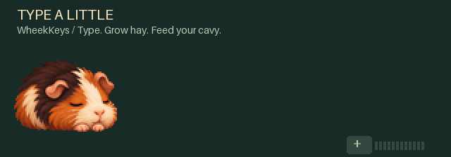

# WheekKeys — 豚鼠桌宠

**敲键盘长牧草，豚鼠跑来吃。**

[English](README.md) · 简体中文



[](https://github.com/destined108/WheekKeys/releases/latest/download/WheekKeys-Windows-x64.zip)
[制作自己的豚鼠](#制作自己的豚鼠) — 把[这个 skill](.agents/skills/create-guinea-pig/SKILL.md) 和自家豚鼠的照片发给 agent 即可。

> 适用于 Windows 10/11 的 64 位试玩版。下载 ZIP，解压后运行 `WheekKeys.exe`，无需安装 Python。程序尚未签名。[版本说明与校验文件](https://github.com/destined108/WheekKeys/releases/latest) · [CI 构建](https://github.com/destined108/WheekKeys/actions/workflows/windows.yml)。

## 一只陪你打字的小豚鼠

启动 WheekKeys，让它待在屏幕角落，然后照常在记事本或其他应用里打字。每按一次键，就长出一根牧草，草丛下方的小按键图标也会亮一下。攒满十二格，小豚鼠「土豆」就会跑过来，嚼几口草，再回到原来的位置趴下休息。一直按住同一个键只算一次。

- 支持 Windows 10/11。透明小窗默认显示在屏幕右下角，并保持在其他窗口上方。
- 按住鼠标左键可以拖动；右键菜单可以手动喂草或退出。选中桌宠窗口后，也可以按 Esc 退出。
- 不用注册账号，没有积分系统，也不依赖联网服务。
- 加上 `--demo` 参数会播放循环演示（默认速度下为十秒，低速时会等完整动作结束再重播），**演示模式不会读取你的按键**。想让它随打字长草，正常启动、不加这个参数即可。

GIF 和程序内的演示使用相同的动画逻辑和播放节奏：模拟十二次按键，展示长草、吃草和回去休息的过程。GIF 由程序渲染生成，不是 Windows 桌面录屏。正常使用时，牧草会随着你的实际打字速度生长。

## 托盘、模型与设置

宠物右键和托盘菜单中的 **语言** 子菜单提供 **跟随系统、简体中文、繁體中文、English**，选择后立即生效，下次启动也会保留。跟随系统时，中国大陆和新加坡的中文环境使用简体，台湾、香港和澳门的中文环境使用繁体，其他语言使用英文；语言标记明确指定简体或繁体时，以标记为准。Windows 读取当前用户的显示语言，不受日期、数字等区域格式影响；更改系统显示语言后，请重新启动 WheekKeys。以下菜单名称同时列出中文和英文，方便对照。

Windows 版启动后，任务栏通知区域会出现豚鼠图标；如果没看到，可以展开托盘里的隐藏图标。右键点击托盘图标或宠物，都可以切换模型、导入花色、打开设置、手动喂草或退出。托盘菜单还可以隐藏宠物，再把它叫回来。

在 **设置…（Settings…）** 中，可以调整：

- 吃一次草需要按多少次键：1～1000 次，默认 12 次。
- 移动速度：0.5～2 倍。
- 显示大小：0.5～2 倍。
- 是否始终显示在其他窗口上方。
- 是否暂停打字互动：暂停后不再随打字长草，已经开始的动作会继续，也可以手动喂草。

点击 **保存（Save）** 后立即生效，下次启动也会保留。拖动后的窗口位置同样会记住。

**宠物模型（Pet model）** 用来选择已安装的角色，目前内置「土豆」一个模型。通过 **导入模型…（Import model…）** 可以添加包含完整动作的新角色；**导入花色…（Import colors…）** 只改变颜色。想制作自己的模型，可以先用 **导出模型模板…（Export model template…）** 导出当前角色，再修改图片和名称。切换模型时会恢复该模型自带的花色，详细格式见[模型包说明](models/README.zh-CN.md)。

设置、导入的模型和花色都保存在 `%APPDATA%\WheekKeys` 中，不需要修改 exe。如果托盘启动失败，仍可以使用宠物右键菜单；此时会禁用隐藏功能，避免隐藏后无法找回。

## 会记录我输入的内容吗？

不会。Windows 版通过键盘事件通知统计按键次数，快速按下又松开的按键也能计入。程序不会把按键转换为文字，不读取窗口标题或剪贴板，也不会保存或上传按键记录。

为了避免长按被重复计数，程序只在内存中暂存尚未处理的按键次数，以及当前仍按住的键；松开后便移除对应的状态。Shift、Ctrl、Alt、Win 等修饰键和鼠标按键不计数。程序不会拦截正常输入，退出时也会停止监听。通常无需管理员权限，但无法检测 Windows 安全桌面（例如用户账户控制提示界面）中的按键。

## 从源码运行

先安装 Python 3.12，并确保安装了 Tk 图形界面组件。然后在项目根目录执行：

```powershell
py -3.12 -m venv .venv
.venv\Scripts\python -m pip install -r requirements.txt
.venv\Scripts\python -m wheekkeys
```

只想看看动画，可以启动演示模式。这个模式不会监听其他应用中的按键，在有图形界面的 Linux 和 macOS 上也能预览动画：

```powershell
.venv\Scripts\python -m wheekkeys --demo
```

使用自己的花色文件：

```powershell
.venv\Scripts\python -m wheekkeys --skin skins\template.json
```

## 开发与打包

安装依赖、运行测试并重新生成演示 GIF：

```sh
python -m pip install -r requirements.txt
python -m unittest discover -s tests -v
python -m docs.make_demo
```

在 Windows 上打包成可执行文件：

```powershell
python -m pip install pyinstaller==6.16.0
python -m PyInstaller --noconfirm --clean --onefile --windowed --name WheekKeys --icon assets/wheekkeys.ico --hidden-import pystray._win32 --add-data "skins;skins" --add-data "assets;assets" launcher.py
```

生成的程序位于 `dist/WheekKeys.exe`。GitHub Actions 会在 Windows 上运行测试并打包。推送版本标签（`v*`）后，会将通过测试的 exe、便携 ZIP 和 SHA-256 校验文件发布到 Release；普通分支构建只保存 CI 产物。

在 Windows 上手动测试时，先正常启动程序，不加 `--demo`，再切到记事本快速按十二次键。检查按键图标是否随之闪亮、十二格进度是否填满，以及豚鼠是否完成吃草和返回休息的动作。再确认长按只计一次，并检查拖动、退出、演示模式和自定义花色是否正常。

自动测试覆盖按键计数、画面反馈、动画时序和花色替换；Windows 上的实际窗口显示和键盘监听仍需实机验证。

## 制作自己的豚鼠

把 [create-guinea-pig skill](.agents/skills/create-guinea-pig/SKILL.md) 和豚鼠照片或描述发给你的编程 agent，再复制下面这段话：

> 请读取本仓库的 `.agents/skills/create-guinea-pig/SKILL.md`，按参考图制作我的豚鼠。名字是：____。如果换花色就能满足需求，只做花色；否则制作完整模型。请检查结果，给我预览和可导入的文件，并告诉我怎么安装。不要把我的参考照片放进交付文件。

如果 agent 支持发现仓库 skill，可以直接调用 **`$create-guinea-pig`**。如果不支持，就把 [SKILL.md](.agents/skills/create-guinea-pig/SKILL.md) 的内容粘贴到聊天中。agent 需要能访问本仓库和 Python 依赖；绘制新角色还需要图像工具，或由你提供动作图。

**换花色和制作完整模型都用同一个 skill。** agent 会选择合适的方式，准备资源，再告诉你如何导入：

- **只换花色：** 你会拿到 `skin.json` 和预览。右键点击宠物或托盘图标，选择“导入花色…”，选中这个 JSON 文件。
- **制作新模型：** 你会拿到模型 ZIP 和预览。解压后选择“导入模型…”，选中包含 `model.json` 的文件夹。

向项目贡献时，花色资源放在 `skins/community/<模型名>/`，完整模型放在 `models/community/<模型名>/`，下载用的 ZIP 放在 `dist/`。程序会把导入的资源复制到用户目录，不需要往 exe 旁边放文件，也不需要重新打包。想手动画模型的用户仍可查阅[模型格式说明](models/README.zh-CN.md)。

欢迎在 Issue 分享预览，或提交包含资源的 PR。如果这只小豚鼠让你笑了一下，也欢迎点个 Star，或把十秒演示分享给同样喜欢豚鼠的朋友。

项目采用 MIT 许可证。角色图片参考用户提供的示例，使用 AI 辅助生成；项目提供的美术素材同样采用 MIT 许可证。
